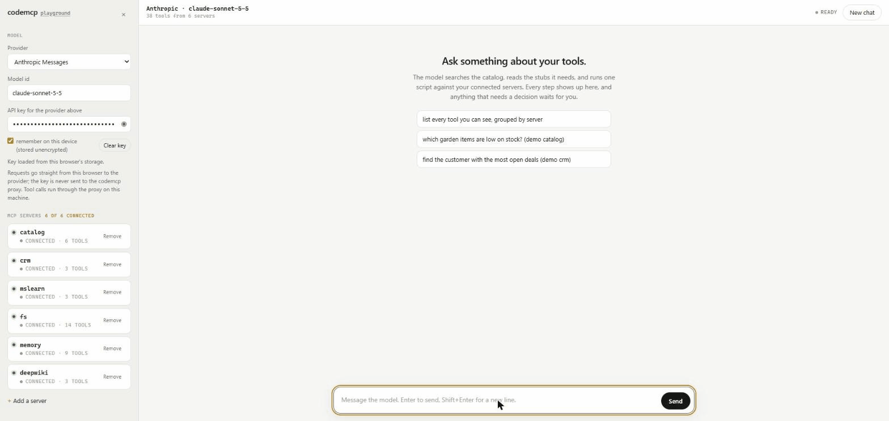

# codemcp

One MCP server in front of all the MCP servers you already use. Your model sees three tools, `search`, `describe` and `execute`. It writes a short TypeScript program against typed stubs generated from your tools' schemas, and codemcp runs that program in a sandbox that can call tools and nothing else.



> Pre-alpha. APIs will change. codemcp speaks MCP 2025-11-25 through SDK 1.x today; the move to SDK v2 and the 2026-07-28 revision is next. [docs/STATUS.md](docs/STATUS.md) lists what works and what does not yet.

## Why

Tool definitions for a handful of MCP servers can eat 50K tokens before you have said a word. With codemcp the model starts with about 1K and looks the rest up when it needs it.

Loops, filters and joins over tool results run inside the sandbox. Only the final answer comes back to the model, not every intermediate row.

Model-written code is attacker-controlled, because that is what prompt injection makes it. The default executor is QuickJS compiled to WebAssembly on a worker thread, with memory, stack and deadline limits enforced from outside. Your credentials never enter the sandbox; the only thing inside is a JSON bridge to stubs the proxy has already authorized.

Governance sits where it can be enforced: allow, deny or approve rules per tool and per principal, read-only inference from MCP annotations, pinned tool definitions with drift detection, call and byte budgets, and an audit record of every bridged call. When a call needs a human, the sandbox parks mid-call and continues when you decide. A denial is catchable, so the script can fall back instead of losing its work.

It works in front of Claude Code, Cursor, VS Code, Codex CLI, Claude Desktop and any other MCP client, with any model.

## Try it

```bash
npx codemcp-cli import --write   # find mcp.json files from Claude Code, Cursor, VS Code, Claude Desktop
npx codemcp-cli serve            # run the proxy over stdio; point your client here
```

[examples/clients/README.md](examples/clients/README.md) has the config snippet for each client.

To explore from a checkout:

```bash
pnpm install && pnpm build
pnpm --filter codemcp-examples basic   # scripted walkthrough, no model needed
pnpm --filter codemcp-examples ui      # chat with your own key at http://localhost:8765
```

[examples/README.md](examples/README.md) explains each example. To point them at your own servers, see [examples/real/README.md](examples/real/README.md).

## Several servers, several credentials

Every server in `codemcp.config.json` becomes a namespace: `tools.github.*`, `tools.crm.*`. One script can join across them. Secrets go in each server's `env` or `headers` as `${VAR}` references, filled from the proxy's environment at startup, and the sandbox never sees them. [docs/AUTH.md](docs/AUTH.md) covers credentials, identity and approvals.

## Packages

| Package | Purpose |
|---|---|
| [`codemcp-cli`](packages/proxy) | The `codemcp` command and MCP server |
| [`codemcp-core`](packages/core) | Registry, JSON Schema to TypeScript stubs, bridge protocol, policy, budgets, pinning, audit, code normalization, search |
| [`codemcp-executor-quickjs`](packages/executor-quickjs) | Default sandbox: QuickJS-WASM on a worker thread |
| [`codemcp-conformance`](packages/conformance) | Hostile-script suite every executor must pass |
| [`spec/`](spec) | Language-neutral definition: error codes, schemas, policy cases, stub goldens, conformance cases. Ports in other languages test against it |

## Sandbox tiers

QuickJS-WASM in a worker is tier 0 and the only one built. Planned: Monty for Python, a Deno subprocess, Docker with gVisor, Firecracker through self-hosted E2B or microsandbox, and remote adapters. Node `vm`, `isolated-vm`, Pyodide, Bun and bare `workerd` are deliberately absent; their own maintainers say they are not a boundary. [docs/THREAT_MODEL.md](docs/THREAT_MODEL.md) has the reasoning.

## License

Apache-2.0. See [LICENSE](LICENSE).
